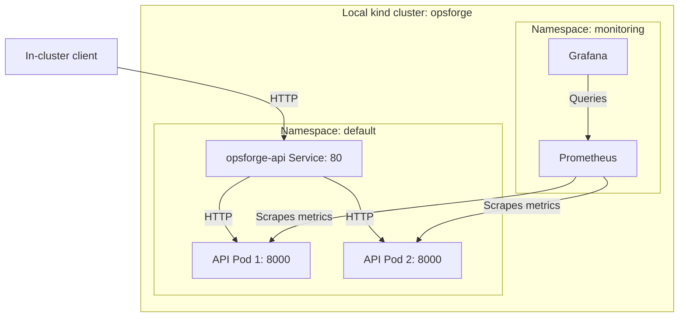

# OpsForge architecture

This guide describes the configuration committed in the repository. Check the
live environment with `make api-status` and `make monitoring-status`.

## Purpose

OpsForge is a local environment for learning how to operate a service throughout
its lifecycle: test the code, build an image, check it for security issues,
publish it, deploy it, observe its behavior, and recover from a failed update.

The FastAPI application has a deliberately small HTTP surface. This makes it
easier to connect infrastructure changes to observable results. For example,
deleting a Pod demonstrates replacement, and requesting a missing route
produces a `404` that appears in the request counter.

## Runtime architecture

The lab runs on Windows using Ubuntu/WSL and Docker. kind creates the Kubernetes
node as a Docker container. The API and monitoring stack run inside that
single-node cluster.

The diagram shows application traffic and metrics collection. Controllers,
monitoring support components, and storage are described below.

| Setting | Current configuration |
| --- | --- |
| Cluster / kubectl context | `opsforge` / `kind-opsforge` |
| Node | One node, `opsforge-control-plane` |
| API namespace | `default` |
| Deployment / container | `opsforge-api` / `api` |
| Desired API replicas | Two |
| API Service | `ClusterIP`, port `80` to named container port `http` (`8000`) |
| Monitoring namespace / Helm release | `monitoring` / `monitoring` |
| Monitoring chart | `kube-prometheus-stack`, version `92.17.0` in the Makefile |
| StorageClass | `standard`, using the local-path provisioner in the validated lab |

### What runs the application

| Component | Responsibility in OpsForge |
| --- | --- |
| Docker image | Packages Python, dependencies, and application code. |
| kind | Provides a local Kubernetes cluster using Docker containers as nodes. |
| Pod | Runs one API container with its configuration and security settings. |
| Deployment | Declares the desired application state and manages updates through ReplicaSets. |
| ReplicaSet | Maintains the requested number of Pods for a particular Pod template. |
| Service | Provides a stable internal address for reaching selected ready Pods. |
| Readiness probe | Calls `/health` to determine whether a Pod is ready for Service traffic. |

The API is stateless: it has no application database or persistent user data.
Its root endpoint returns service metadata, including the hostname of the Pod
that handled the request.

Local access uses `kubectl port-forward`. When invoked against a Service, it
selects a backing Pod and opens a tunnel to that Pod. One session does not
exercise Service load balancing. If the selected Pod disappears, restart the
port-forward. The local API URL is `http://localhost:8000`; Grafana uses
`http://localhost:3000` through its own port-forward.

## From code to a deployed image

GitHub hosts the source code, Actions runs the checks, and GitHub Container
Registry (GHCR) stores the published container images.

1. A pull request runs the `checks` job named `Tests and security`.
2. The job scans current files for secrets, runs the four API and metrics tests,
   checks the Dockerfile, scans the runtime image, and validates dashboard JSON.
3. On a successful push to `main`, it also uploads the image archive as
   `scanned-container-image`.
4. The separate `publish` job downloads that archive, loads it, and pushes the
   image to `ghcr.io/dev-ugo/opsforge-api:<commit-sha>`.
5. To deploy a chosen image, update its reference in `k8s/api/deployment.yaml`
   and run `make api-deploy` locally.

The publisher uses the archive that passed the critical-vulnerability gate;
it does not rebuild the image after that gate. Pull requests do not publish.

| Identifier | What it identifies |
| --- | --- |
| Image tag `<commit-sha>` | The source commit associated with a CI-published image. |
| Image digest `@sha256:...` | The image content referenced by the Kubernetes manifest. |
| API `version` field | The application version, currently `0.1.0`; it does not identify a commit or digest. |

Image publication is automated; deployment to kind is manual. Building a local
image with `make api-build` does not change the manifest's GHCR digest.

## Observability

Metrics help answer how much traffic the service receives, whether requests
fail, and how long the application takes to process them.

| Component | Responsibility in OpsForge |
| --- | --- |
| Helm | Installs and updates the monitoring stack from a versioned chart and local values file. |
| Prometheus Operator | Configures monitoring workloads and target discovery from Kubernetes custom resources. |
| ServiceMonitor | Describes which Service to discover and which endpoint to scrape. |
| Prometheus | Scrapes and stores time series, evaluates queries, and evaluates enabled alert rules. |
| Grafana | Queries Prometheus to display dashboards. |
| kube-state-metrics | Exposes Kubernetes object state, such as desired and available Deployment replicas. |
| node-exporter | Exposes metrics about the node environment. |
| Alertmanager | Handles routing and grouping of alerts received from Prometheus. |

The chart includes default Kubernetes dashboards and alert rules. OpsForge-specific
alert rules and an external notification receiver have not been configured.
Some optional control-plane scrape targets are disabled for this local setup;
this does not disable the corresponding Kubernetes components.

### How Prometheus finds the API

The ServiceMonitor lives in `monitoring` and has the label `release: monitoring`.
Its namespace selector targets Services in `default`; its Service selector
matches `app: opsforge-api`.

The endpoint uses the Service port named `http`, path `/metrics`, a scrape
interval of `15s`, and a timeout of `5s`. The resulting targets are the individual
API Pod endpoints on port `8000`, so both replicas are observed independently.

Prometheus requests metrics from the API; Grafana queries Prometheus.
The Prometheus-generated `up` metric records whether each scrape succeeded.

### Metrics and dashboard

The application exposes two metric families:

- `opsforge_http_requests_total`: a counter labelled by HTTP status.
- `opsforge_http_request_duration_seconds`: a histogram with buckets, a sum,
  and a count for processing duration until response headers.

Health checks and metrics scrapes are excluded from both. Metrics are held
in memory per process and reset on restart; dashboard queries apply `rate()`
before aggregating replicas.

The **OpsForge API Overview** dashboard contains four panels:

| Panel | Meaning | Interpretation |
| --- | --- | --- |
| Metrics targets UP | Sum of successful API scrape targets. | Normally two; it does not prove that a rollout completed or every route works. |
| Requests per second | Combined request rate across replicas and statuses. | Includes `404` responses; excludes `/health` and `/metrics`. |
| HTTP 5xx per second | Combined rate of server-error responses. | Falls back to zero only when a request-rate series is available. |
| Mean API processing time | Duration sum rate divided by count rate, converted to milliseconds. | Measures server processing until headers, excluding client network time. |

Without request observations, some series may be absent and mean latency may
be undefined. Rate queries also need multiple scrapes. An empty traffic panel
alone is insufficient to conclude that the API is down; inspect scrape targets
and the application health response as well.

### Dashboards as code

`monitoring/dashboards/opsforge-api.json` is the dashboard source.
`kustomization.yaml` generates a ConfigMap named `opsforge-api-dashboard` with
the label `grafana_dashboard: "1"`. The Grafana dashboard sidecar watches the
`monitoring` namespace and makes the JSON available for provisioning.

Edit the JSON and run `make monitoring-dashboard`. The stable ConfigMap name
and dashboard UID update the existing provisioned dashboard. Git stores the
dashboard definition alongside the application and infrastructure configuration.

Local `make monitoring-dashboard-check` validates JSON syntax and renders the
Kustomization. CI currently validates JSON syntax only; it does not validate
PromQL behavior or render the dashboard in Grafana.

### Monitoring storage

| Component | Persistent volume request | Retention setting |
| --- | --- | --- |
| Prometheus | `8Gi` | `3d`, with a `6GiB` size retention setting. |
| Grafana | `2Gi` | Stores Grafana state; provisioned dashboard source remains in Git. |
| Alertmanager | `1Gi` | Stores Alertmanager state. |

These volumes use `standard` storage and keep data across ordinary Pod
replacements. The data remains local to the kind node; deleting the cluster or
losing the underlying storage can remove it. Persistence is not a backup.

## Security currently in place

| API control | Purpose |
| --- | --- |
| Non-root UID/GID `10001` | Runs the API without root identity. |
| `allowPrivilegeEscalation: false` | Prevents the container process from gaining additional privileges through privilege escalation. |
| Dropped Linux capabilities | Removes additional capabilities from the API container. |
| Read-only root filesystem | Prevents writes to the API container's root filesystem. |
| `RuntimeDefault` seccomp | Applies the container runtime's default syscall filtering profile. |
| No automatic service-account token mount | Avoids giving this API a token it does not need. |
| Runtime image without pip and ensurepip | Removes package-installation tooling from the final image. |

These settings apply to the API. Monitoring components have their own access
requirements and chart configuration.

The workflow pins third-party Actions to commit SHAs, disables persisted checkout
credentials, and grants package-write permission only to the publisher.
Dependabot checks GitHub Actions dependencies weekly.

Failing tests and detected secrets block CI. CRITICAL image vulnerabilities
block CI and publication; HIGH findings are temporarily report-only while their
review is paused. Local `make api-scan` blocks both severities by default.
Secret scanning covers current files, excluding Git history, and reports
affected filenames without intentionally printing matched secret values.

See [SECURITY.md](../SECURITY.md) for the recorded assessment. Hardening reduces
exposure but does not patch open vulnerabilities. A public repository or image
does not expose a running API by itself; code and images still require security
review.

## Failure and recovery already exercised

A nonexistent image tag created a new Pod that could not pull its image.
With two desired replicas and the default rolling-update percentages,
Kubernetes kept both old ready Pods while attempting to start one extra Pod.

The rollout stalled while sampled `/health` requests continued to succeed.
An explicit `kubectl rollout undo` restored the verified healthy revision.
Kubernetes did not automatically perform that rollback.

Two old Pods can therefore remain scrapeable while a new release is blocked.
A green target count alone does not establish deployment success. The
[failed rollout runbook](runbooks/failed-rollout.md) records recovery commands.

## Current scope and limits

- All replicas share one local node and computer; they cannot provide
  availability through loss of that node or host.
- Access is local through port forwarding. There is no configured public
  application endpoint, Ingress, or TLS termination.
- The API has no database, user authentication, or business-data persistence.
- Logs can be inspected with Kubernetes tools; centralized log storage and
  distributed tracing are not installed.
- GitOps synchronization, autoscaling, OpsForge-specific alerting, and tested
  backup restoration have not been implemented.

## Repository guide

| Path | What to look for |
| --- | --- |
| `app/main.py` | Routes and HTTP metrics instrumentation. |
| `tests/` | API response and metrics behavior tests. |
| `Dockerfile` | Shared base, test stage, and final runtime stage. |
| `k8s/api/` | API Deployment, security settings, readiness probe, and Service. |
| `k8s/deployment.yaml`, `k8s/service.yaml` | Separate introductory NGINX workload. |
| `.github/workflows/ci.yml` | Checks, vulnerability policy, and GHCR publication. |
| `.github/dependabot.yml` | Scheduled GitHub Actions dependency checks. |
| `monitoring/values-kind.yaml` | Monitoring chart configuration and storage requests. |
| `monitoring/manifests/` | API ServiceMonitor. |
| `monitoring/dashboards/` | Grafana JSON source and ConfigMap generation. |
| `Makefile` | Local commands wrapping Docker, Kubernetes, and Helm. |
| `SECURITY.md` | Recorded security assessment and CI policy. |
| `docs/runbooks/failed-rollout.md` | Failed image rollout recovery procedure. |

## References

- [Kubernetes Deployments](https://kubernetes.io/docs/concepts/workloads/controllers/deployment/)
- [Kubernetes Services](https://kubernetes.io/docs/concepts/services-networking/service/)
- [Kubernetes port forwarding](https://kubernetes.io/docs/tasks/access-application-cluster/port-forward-access-application-cluster/)
- [Prometheus Operator and ServiceMonitors](https://prometheus-operator.dev/docs/developer/getting-started/)
- [Grafana provisioning](https://grafana.com/docs/grafana/latest/administration/provisioning/)
- [Kubernetes security contexts](https://kubernetes.io/docs/tasks/configure-pod-container/security-context/)
- [Kubernetes persistent volumes](https://kubernetes.io/docs/concepts/storage/persistent-volumes/)
- [GitHub Actions security](https://docs.github.com/en/actions/reference/security/secure-use)